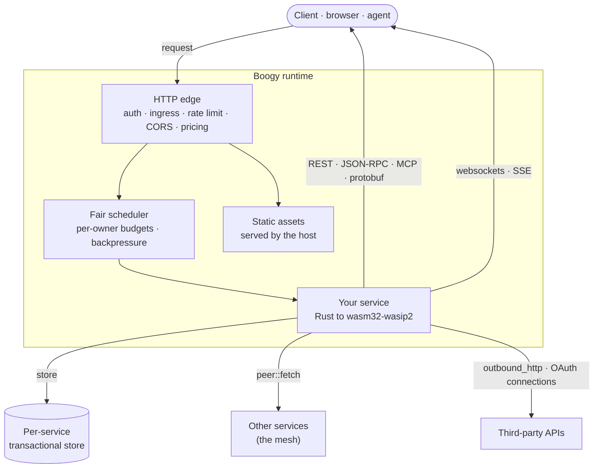

<h1 align="center">Boogy</h1>

<p align="center">
  <b>Vibe whole apps into production.</b><br/>
  Frontend, API, and data from one Rust crate compiled to <code>wasm32-wasip2</code> —
  on a shared runtime with an isolated transactional store, capability security,
  and transactions that span services.
</p>

<p align="center">
  <a href="https://boogy-ai.github.io/"><b>Developer hub</b></a>
  ·
  <a href="https://boogy-ai.github.io/boogy-sdk/">API reference</a>
  ·
  <a href="https://boogy.ai/llms.txt">Agent bootstrap</a>
  ·
  <a href="https://boogy.ai">boogy.ai</a>
</p>

---

## Start here — install the plugin

You don't start by learning an SDK. Install the plugin and ask your agent for
what you want; it carries the skills, the platform tools and the rules, and it
does the building.

```
claude plugin marketplace add Boogy-ai/boogy-superpowers
claude plugin install boogy-superpowers
```

Then, **inside Claude Code**:

```
/reload-plugins
```

**Do not skip that.** Nothing activates until it runs, and there is no error
saying so — the session simply behaves as though the plugin were never
installed.

That's the setup. Now ask for what you want: *"build me a link shortener with a
web page, and deploy it."*

<details>
<summary><b>Not on Claude Code?</b></summary>

Point any MCP-capable agent at Boogy's public, anonymous MCP server:

```
claude mcp add boogy https://api.boogy.ai/mcp
```

It serves guidance (`get_started`, `list_skills`, `get_skill`,
`manifest_reference`), host-truth validation (`validate_manifest`,
`check_service`), and device-flow sign-in (`login` shows the user a link to
click; they sign in and the token returns to the agent — no CLI needed for
auth). Deploying needs the CLI (`boogy deploy`) or the `/v1` REST API.

Or read **[boogy.ai/llms.txt](https://boogy.ai/llms.txt)** and follow it.
Building in a repo you'll revisit without the plugin? `boogy skills install`
vendors the skills into your project.

</details>

**Humans** — the [developer hub](https://boogy-ai.github.io/) routes you to the
docs, the SDK, and the catalog.

## What a service gets

You write handlers. The runtime gives each deployed service:

| | |
|---|---|
| **Surfaces** | REST, JSON-RPC, MCP tools, and protobuf RPC — Connect, gRPC-Web and native gRPC over one mount. `openapi.json` and `openrpc.json` are generated and served for you. |
| **Data** | A private **relational, ACID** store. Declare models in Rust; indexes and columns reconcile on deploy. One transaction can span a whole cross-service call tree. |
| **Frontend** | Ship TypeScript or JS **source** — the platform transpiles and serves it, no Node and no build step on your machine. Static site, full-stack, or backend-only. |
| **Identity** | Platform accounts, "Sign in with Boogy" for your end users, per-service pairwise pseudonyms, API keys, scopes, and on-behalf-of delegation between services. |
| **Security** | Capabilities are **deny-by-default** and declared in the manifest. Ingress mode, rate limits and CORS are host-enforced, not app code. |
| **Money** | Charge per route execution against a prepaid ledger, and earn a share of the revenue an instance of your module generates. |
| **The rest** | Background jobs, real-time channels over websockets, streaming responses, file storage, cryptographic signing, OAuth connections to third-party accounts, outbound HTTP behind an allowlist, and LLM completions across providers. |

Services call each other **in-process** via `peer::fetch` — no network hop, and
the caller's transaction and identity carry through.

## How it fits together



## Repositories

| Repo | What it is |
|------|------------|
| **[boogy-sdk](https://github.com/Boogy-ai/boogy-sdk)** | The SDK + `boogy` CLI — `Router`, typed handlers, `wit_glue!`, store helpers, `McpServer`, the WIT interfaces. Full [architecture overview](https://github.com/Boogy-ai/boogy-sdk/blob/main/ARCHITECTURE.md) and [API reference](https://boogy-ai.github.io/boogy-sdk/). |
| **[boogy-web](https://github.com/Boogy-ai/boogy-web)** | The browser SDK (`@boogy/web`) — add user sign-in ("Sign in with Boogy") and authenticated requests to your app's frontend with one `fetch()`. |
| **[boogy-superpowers](https://github.com/Boogy-ai/boogy-superpowers)** | Agent skills that teach a coding agent to build Boogy services well — 40 of them, covering design, data modeling, auth, jobs, pricing, and the platform's limits. |
| **[boogy-catalog](https://github.com/Boogy-ai/boogy-catalog)** | Provisionable, best-practice services — email, payments, multi-chain custodial wallets — you deploy into your own tenant with your own keys. |

---

<p align="center"><sub>MIT OR Apache-2.0</sub></p>
