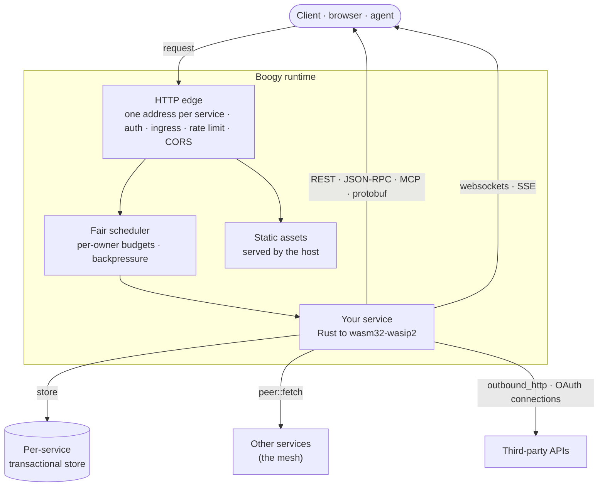

<h1 align="center">Boogy</h1>

<p align="center">
  <b>Skip localhost. Start with a real URL.</b><br/>
  Prompt your agent and every change swaps into production in place, at a real
  address. Services are Rust compiled to <code>wasm32-wasip2</code>, on a shared
  runtime with an isolated transactional store, capability security, and
  transactions that span services.
</p>

<p align="center">
  <a href="https://boogy-ai.github.io/"><b>Developer hub</b></a>
  ·
  <a href="https://boogy-ai.github.io/boogy-sdk/">API reference</a>
  ·
  <a href="https://boogy.ai/llms.txt">Agent bootstrap</a>
  ·
  <a href="https://boogy.ai">boogy.ai</a>
</p>

---

## Start here — install the plugin and the CLI

You don't start by learning an SDK. Install the plugin and ask your agent for
what you want; it carries the skills and the rules, and it does the building.

```
claude plugin marketplace add Boogy-ai/boogy-superpowers
claude plugin install boogy@boogy
```

Then, **inside Claude Code**:

```
/reload-plugins
```

**Do not skip that.** Nothing activates until it runs, and there is no error
saying so — the session simply behaves as though the plugin were never
installed.

Signing in and deploying are the `boogy` CLI's job:

```
cargo install --locked --git https://github.com/Boogy-ai/boogy-sdk boogy-cli
boogy login
```

`boogy login` shows a link and a one-time code; you sign in in the browser, and
the CLI keeps the token in its own credentials file — it never passes through
your agent. A first-time account picks a **handle**, its username (4 to 30
characters: lowercase letters, digits and `-`).

That's the setup. Now ask for what you want: *"build me a link shortener with a
web page, and deploy it."* It goes live at an address of its own, such as
`links-4k2q.boogy.app`, and stays there as you iterate.

<details>
<summary><b>Not on Claude Code?</b></summary>

Vendor the skills into your project — `boogy skills install`, or
`npx degit Boogy-ai/boogy-superpowers/skills .claude/skills` — and install the
CLI as above. Or have your agent read
**[boogy.ai/llms.txt](https://boogy.ai/llms.txt)** and follow it.

Any MCP-capable agent can also use Boogy's public, anonymous MCP server:

```
claude mcp add boogy https://api.boogy.ai/mcp
```

It serves guidance (`get_started`, `list_skills`, `get_skill`,
`manifest_reference`) and host-truth validation (`validate_manifest`,
`check_service`). It neither signs in nor deploys: that is `boogy login` and
`boogy deploy`, or the `/v1` REST API.

</details>

**Humans** — the [developer hub](https://boogy-ai.github.io/) routes you to the
docs, the SDK, and the catalog.

## What a service gets

You write handlers. The runtime gives each deployed service:

| | |
|---|---|
| **An address** | Every service is served at the root of its own address, `<name>-<suffix>.boogy.app`, which stays the same as you redeploy — and a redeploy drops no requests. Bring your own domain when you want one. |
| **Surfaces** | REST, JSON-RPC, MCP tools, and protobuf RPC (Connect and gRPC-Web) from the same handlers. `openapi.json` and `openrpc.json` are generated and served for you. |
| **Data** | A private **relational, ACID** store. Declare models in Rust; indexes and columns reconcile on deploy. One transaction can span a whole cross-service call tree. |
| **Frontend** | Ship TypeScript or JS **source** — the platform bundles it at deploy and serves it on the same origin as your API. No Node and no build step on your machine. Static site, full-stack, or backend-only. |
| **Identity** | Platform accounts, "Sign in with Boogy" for your end users, a different pseudonym per service so apps can't correlate them, API keys, scopes, and on-behalf-of delegation between services. |
| **Security** | Capabilities are **deny-by-default** and declared in the manifest. Ingress mode, rate limits and CORS are host-enforced, not app code. |
| **The rest** | Background jobs, real-time channels over websockets, streaming responses, file storage, cryptographic signing, OAuth connections to third-party accounts, outbound HTTP behind an allowlist, and LLM completions across providers. |

Services call each other **in-process** via `peer::fetch` — no network hop, and
the caller's transaction and identity carry through.

## How it fits together



## Repositories

| Repo | What it is |
|------|------------|
| **[boogy-sdk](https://github.com/Boogy-ai/boogy-sdk)** | The SDK + `boogy` CLI — `Router`, typed handlers, `wit_glue!`, store helpers, `McpServer`, the WIT interfaces. Full [architecture overview](https://github.com/Boogy-ai/boogy-sdk/blob/main/ARCHITECTURE.md) and [API reference](https://boogy-ai.github.io/boogy-sdk/). |
| **[boogy-web](https://github.com/Boogy-ai/boogy-web)** | The browser SDK (`@boogy/web`) — add user sign-in ("Sign in with Boogy") and authenticated requests to your app's frontend with one `fetch()`. |
| **[boogy-superpowers](https://github.com/Boogy-ai/boogy-superpowers)** | The Boogy skills, installed as the `boogy` plugin: 51 skills that teach a coding agent to build Boogy services well — design, data modeling, auth, jobs, frontends, custom domains, and the platform's limits. |
| **[boogy-catalog](https://github.com/Boogy-ai/boogy-catalog)** | Provisionable, best-practice services — email, payments, custodial wallets, governance — you deploy into your own tenant with your own keys. |

---

<p align="center"><sub>MIT OR Apache-2.0</sub></p>
