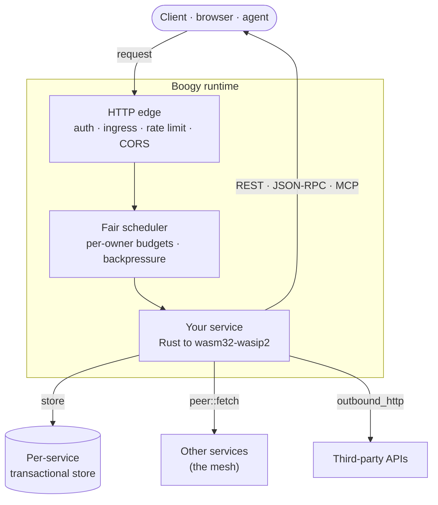

<h1 align="center">Boogy</h1>

  <b>Vibe whole apps into production.</b> 
  Frontend, API, and data from one Rust crate compiled to <code>wasm32-wasip2</code> —
  on a shared runtime with an isolated transactional store, capability security,
  and transactions that span services.

  <a href="https://boogy-ai.github.io/"><b>Developer hub</b></a>
  ·
  <a href="https://boogy-ai.github.io/boogy-sdk/">API reference</a>
  ·
  <a href="https://boogy.ai">boogy.ai</a>

---

## Repositories

| Repo | What it is |
|------|------------|
| **[boogy-sdk](https://github.com/Boogy-ai/boogy-sdk)** | The SDK + `boogy` CLI — `Router`, typed handlers, `wit_glue!`, store helpers, `McpServer`. Full [architecture overview](https://github.com/Boogy-ai/boogy-sdk/blob/main/ARCHITECTURE.md) and [API reference](https://boogy-ai.github.io/boogy-sdk/). |
| **[boogy-superpowers](https://github.com/Boogy-ai/boogy-superpowers)** | Agent skills that teach a coding agent to build Boogy services well. |
| **[boogy-catalog](https://github.com/Boogy-ai/boogy-catalog)** | Provisionable, best-practice services — email, payments, governance, multi-chain custodial wallets — you deploy into your own tenant with your own keys. |

## How it fits together

You write handlers; the runtime gives each service a route subtree, an isolated
**relational, ACID** store, a set of capabilities it must declare, and REST /
JSON-RPC / MCP surfaces. Services call each other in-process — and a single
transaction can span that whole call tree.

## Start here

→ **[Developer hub](https://boogy-ai.github.io/)** routes you to the docs, skills,
and catalog.

**Coding agents — zero install.** Connect to Boogy's public, anonymous MCP server
at **`https://boogy.ai/mcp`** (e.g. `claude mcp add boogy https://boogy.ai/mcp`).
It serves guidance (`get_started`, `get_skill`, `manifest_reference`), host-truth
validation (`validate_manifest`, `check_service`), and device-flow sign-in
(`login` shows the user a link to click; they sign in and the token returns to the
agent — no CLI needed for auth). After `login`, deploy via the CLI (`boogy deploy`),
the `/v1` REST API, or the authenticated admin MCP. Building in a repo you'll
revisit? `boogy skills install` vendors the skills into your project.

---

MIT OR Apache-2.0

